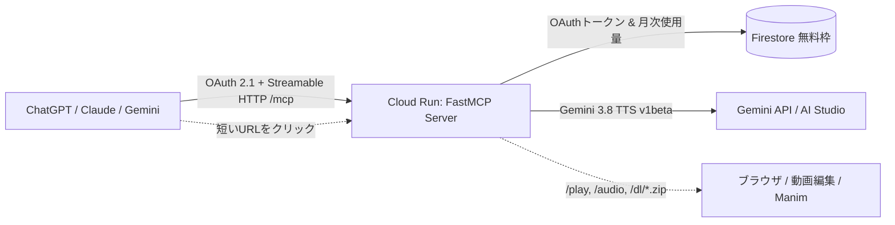

# Gemini 3.8 TTS OAuth 2.1 MCP Server

[English](README.md) | 日本語

ChatGPT Web / Claude.ai / Gemini（Web・Dev Mode・Enterprise）から **OAuth 2.1 ログイン**で使える、Google Cloud Run 完結の [Gemini 3.8 TTS](https://aistudio.google.com/docs/speech-generation) リモート MCP サーバーです。

Google AI Pro / Ultra 特典の月額 Google Cloud クレジットを活かし、ネイティブの **Spend cap** で自動課金を防ぎながら運用できます。

## アーキテクチャ



## 主な特徴

* **自動課金を構造的に防止**: 使う GCP サービスは `Gemini API`（AI Studio 経由）・`Cloud Run`・`Firestore`（[常時無料枠](https://docs.cloud.google.com/free/docs/free-cloud-features)）のみ。`Gemini API` と `Cloud Run` に [Google Cloud Spend cap budgets（自動停止）](https://docs.cloud.google.com/billing/docs/how-to/budgets-spend-caps) を設定し、AI Studio 側も Auto-reload OFF にすることで月 $100 クレジット枠内に収めます。
* **3大クライアントの OAuth 2.1 互換対応**: [FastMCP v4.2.5+](https://pypi.org/project/fastmcp/) の `GoogleProvider` を拡張し、Gemini Connected Apps の非ローテーション要件（[Google Developers](https://developers.google.com/connected-apps/mcp/oauth)）と Claude.ai / ChatGPT のローテーション＋並行リフレッシュ対策（[Claude Docs](https://claude.com/docs/connectors/building/authentication)、[FastMCP #4901](https://github.com/PrefectHQ/fastmcp/issues/4901)）を両立。Firestore 保存時の `H_`/`S_` キー衝突バグ（[google-ads-mcp #136](https://github.com/googleads/google-ads-mcp/issues/136)）および暗号化（`FernetEncryptionWrapper`）も対応済みです。
* **60秒タイムアウト回避（ハイブリッド非同期）**: ChatGPT Web・Claude.ai の約 60 秒ハード上限（[claude-ai-mcp #115](https://github.com/anthropics/claude-ai-mcp/issues/115)）を避けるため、並列生成しつつ最大 25 秒で一旦 `job_id` を返し、`get_job(job_id)` でロングポーリングします。
* **動画編集（NLE / Manim）即戦力パッケージ**: `output_mode="split"` で `scenes/001_*.wav`（48kHz 変換可）・`combined.wav`（無音ギャップ付き）・`subtitles.srt`（UTF-8・2行自動整形）・`manifest.json`（WAV実フレーム数から算出した厳密 `duration_sec` / タイムコード）をオンデマンド ZIP で返します。
* **緩めな 2 段階レート制限＆OOM防御**: 金額では縛らず分・時間ベースの回数（既定：10回/分で警告→30回/分で遮断、60回/時間で警告→120回/時間で遮断）で暴走を防ぎ、メモリキャッシュは 256MB LRU＋15分 TTL で制御します。

## 提供ツール（5本）

| ツール | 役割 |
| :--- | :--- |
| `generate_speech` | 単発読み上げ・複数話者対談・動画シーン別一括生成（WAV / 再生ページ / 動画編集用 ZIP） |
| `get_job` | 25秒を超えるバッチ生成の完了待ち（ロングポーリング） |
| `list_voices` | カスタム声（AI Studio 作成）とプリセット声の検索 |
| `get_usage` | 今月の生成回数・音声時間・推定利用額（Firestore リアルタイム累計） |
| `get_guide` | AI 向けのタグ・声・動画制作・上限リファレンス |

## セットアップ手順（Google Cloud Run）

### Step 1: AI Studio でクレジット紐付け＆APIキー発行

1. [Google AI Studio](https://aistudio.google.com/) の左メニューから **Claim Google Cloud Credits** で特典を適用します（[公式ブログ](https://blog.google/innovation-and-ai/technology/developers-tools/google-cloud-credits-gdp-ai-studio/)）。※初回のみ $5 事前チャージ要件あり。
2. [AI Studio Billing](https://aistudio.google.com/docs/billing) で **Auto-reload（自動チャージ）を OFF** にします。
3. API キーを発行して控えます（`GEMINI_API_KEY`）。

### Step 2: Firestore 作成＆Spend cap（自動停止）設定

1. Google Cloud コンソールで **Firestore** をネイティブモードで作成します（1プロジェクト 1DB まで無料枠あり、[無料枠公式](https://docs.cloud.google.com/free/docs/free-cloud-features)）。
2. **お支払い → 予算とアラート → 予算を作成** から種別 **Spend cap enforcement** を選び、以下2つを作成します（[公式手順](https://docs.cloud.google.com/billing/docs/how-to/budgets-spend-caps)）：
   * `cap-gemini-api`: 対象 `Gemini API` / 上限 **$80**（月 $100 枠の場合）
   * `cap-cloud-run`: 対象 `Cloud Run` / 上限 **$5**

### Step 3: Google OAuth クライアント ID を作成

1. **API とサービス → OAuth 同意画面** でアプリ名とテストユーザー（自分の Gmail）を登録。
2. **認証情報 → 認証情報を作成 → OAuth クライアント ID（ウェブ アプリケーション）** を作成し、Client ID と Client Secret を控えます。

### Step 4: 専用サービスアカウント＆Secret Manager の準備

```bash
export PROJECT_ID="あなたのGCPプロジェクトID"
gcloud config set project "${PROJECT_ID}"

gcloud iam service-accounts create gemini-tts-mcp-sa --display-name="Gemini TTS MCP"
SA_EMAIL="gemini-tts-mcp-sa@${PROJECT_ID}.iam.gserviceaccount.com"
gcloud projects add-iam-policy-binding "${PROJECT_ID}" --member="serviceAccount:${SA_EMAIL}" --role="roles/datastore.user"
gcloud projects add-iam-policy-binding "${PROJECT_ID}" --member="serviceAccount:${SA_EMAIL}" --role="roles/secretmanager.secretAccessor"

printf '%s' "あなたのGEMINI_API_KEY"          | gcloud secrets create gemini-api-key --data-file=-
printf '%s' "あなたのOAUTH_CLIENT_SECRET"     | gcloud secrets create oauth-client-secret --data-file=-
openssl rand -hex 32 | tr -d '\n'            | gcloud secrets create jwt-signing-key --data-file=-
python3 -c "from cryptography.fernet import Fernet; print(Fernet.generate_key().decode(), end='')" \
                                             | gcloud secrets create storage-encryption-key --data-file=-
```

### Step 5: Cloud Run へデプロイ

```bash
gcloud run deploy gemini-tts-mcp \
  --source . \
  --region asia-northeast1 \
  --service-account "${SA_EMAIL}" \
  --allow-unauthenticated \
  --no-cpu-throttling \
  --min-instances 0 \
  --max-instances 1 \
  --memory 1Gi \
  --set-env-vars "BASE_URL=https://placeholder.run.app,GOOGLE_OAUTH_CLIENT_ID=あなたのClientID,ALLOWED_EMAILS=あなたのGmail,GOOGLE_CLOUD_PROJECT=${PROJECT_ID}" \
  --set-secrets "GEMINI_API_KEY=gemini-api-key:latest,GOOGLE_OAUTH_CLIENT_SECRET=oauth-client-secret:latest,JWT_SIGNING_KEY=jwt-signing-key:latest,STORAGE_ENCRYPTION_KEY=storage-encryption-key:latest"
```

デプロイ後に表示された URL（例：`https://gemini-tts-mcp-xxxxx-an.a.run.app`）を2か所に反映します：

1. `BASE_URL` を本番 URL に更新：
   ```bash
   gcloud run services update gemini-tts-mcp \
     --region asia-northeast1 \
     --update-env-vars "BASE_URL=https://gemini-tts-mcp-xxxxx-an.a.run.app"
   ```
2. Step 3 の OAuth クライアント設定に以下を追加して保存：
   * **承認済みの JavaScript 生成元**: `https://gemini-tts-mcp-xxxxx-an.a.run.app`
   * **承認済みのリダイレクト URI**: `https://gemini-tts-mcp-xxxxx-an.a.run.app/auth/callback`
3. ChatGPT Web / Claude.ai / Gemini のカスタム MCP 設定に `https://gemini-tts-mcp-xxxxx-an.a.run.app/mcp` を登録してログインします。

## セキュリティ上の注意

* **OAuth 2.1 + fail-closed 許可リスト**: 全 MCP ツールは `email_verified == true` かつ `ALLOWED_EMAILS` に含まれる Google アカウントのみ許可します。
* **短命の Capability URL**: 再生・ダウンロード用 URL（`/play/{job_id}`・`/audio/{job_id}/...`・`/dl/{job_id}.zip`）は、ブラウザから直接再生・保存できるよう 128-bit ランダム ID による認証なし URL になっています。一時的な秘密リンクとして扱い、第三者へのチャット共有などには含めないでください（約 15 分または Cloud Run のスケールゼロで自動消滅します）。

## ローカルテスト

```bash
PYTHONPATH=src python3 -m unittest discover -s tests -v
```

## 免責事項・ライセンス

本リポジトリは非公式の個人オープンソースプロジェクトであり、Google・OpenAI・Anthropic とは一切関係ありません。

[Apache License 2.0](LICENSE) の下で公開されています。
