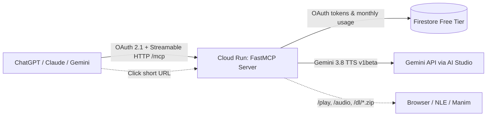

# Gemini 3.8 TTS OAuth 2.1 MCP Server

English | [日本語](README.ja.md)

A self-hosted **OAuth 2.1 Remote MCP Server** for [Gemini 3.8 TTS](https://aistudio.google.com/docs/speech-generation) (`gemini-3.8-flash-lite-tts` & `gemini-3.8-flash-tts`), built for **Google Cloud Run** and compatible with **ChatGPT Web**, **Claude.ai**, and **Gemini (Web / Dev Mode / Enterprise)**.

You can apply monthly Google AI Pro / Ultra Cloud credits toward this deployment.

## Architecture



## Key Features

* **Works across all 3 major Web MCP clients**: Extends [FastMCP v4.2.5+](https://pypi.org/project/fastmcp/) `GoogleProvider` to bridge the refresh-token spec conflict between [Gemini Connected Apps](https://developers.google.com/connected-apps/mcp/oauth) (non-rotating refresh tokens required) and [Claude.ai](https://claude.com/docs/connectors/building/authentication) / ChatGPT (rotating refresh tokens + single-flight grace cache for [FastMCP #4901](https://github.com/PrefectHQ/fastmcp/issues/4901)). Includes optional `MultiAuth` for [Gemini Enterprise](https://docs.cloud.google.com/gemini/enterprise/docs/connectors/custom-mcp-server/set-up-custom-mcp-server).
* **Spend caps** can pause Gemini API and Cloud Run usage. Billing and enforcement can lag, so charges can exceed a cap. Source deployments also use Cloud Build and Artifact Registry, which can incur separate build and image storage charges.
* **Beats the 60-second client timeout**: Parallelizes multi-scene synthesis with a 25s sync window; longer batches return a `job_id` for long-polling via `get_job` ([claude-ai-mcp #115](https://github.com/anthropics/claude-ai-mcp/issues/115)).
* **Video-editing ready (`output_mode="split"`)**: Generates an on-demand ZIP containing `scenes/001_*.wav` (optional 48 kHz video standard), `combined.wav` (with configurable silence gaps), UTF-8 `subtitles.srt` (auto-wrapped to 2 lines), and `manifest.json` (exact frame-measured `duration_sec` and timecodes for Premiere Pro, DaVinci Resolve, Final Cut Pro, CapCut, and Manim).
* **Hardened for production**: Fail-closed `ALLOWED_EMAILS` allowlist + `email_verified` check, uniform `K_<sha256>` Firestore key sanitization (avoids [google-ads-mcp #136](https://github.com/googleads/google-ads-mcp/issues/136)), `FernetEncryptionWrapper`, 256 MB LRU + 15 min TTL memory cap, non-root Docker container, and two-stage per-user sliding-window rate limits (soft warn → hard block).

## MCP Tools (5)

| Tool | Description |
| :--- | :--- |
| `generate_speech` | Single-speaker speech, multi-speaker dialogue (`merged`), or scene-by-scene video VO bundle (`split`). Returns short playback/download URLs and exact `duration_sec`. |
| `get_job` | Long-polls an in-progress batch job (up to 25s per call) until completion. |
| `list_voices` | Lists your custom AI Studio voices (Voice Design / Remix / Replication) and prebuilt studio voices. |
| `get_usage` | Real-time monthly request count, audio minutes, and estimated USD spend from Firestore. |
| `get_guide` | Progressive-disclosure AI reference (`overview`, `video`, `tags`, `voices`, `limits`). |

## Quick Deploy (Google Cloud Run)

### 1. Claim Credits & Create Gemini API Key

1. In [Google AI Studio](https://aistudio.google.com/), claim your monthly Google Cloud credits ([guide](https://blog.google/innovation-and-ai/technology/developers-tools/google-cloud-credits-gdp-ai-studio/)). *(Note: Gemini API credit drawdown requires a $5 initial prepayment.)*
2. Disable **Auto-reload** in [AI Studio Billing](https://aistudio.google.com/docs/billing).
3. Create an API key (`GEMINI_API_KEY`).

### 2. Enable Firestore & Set Spend Caps

1. In Google Cloud Console, create a **Firestore** database in Native mode (1 free database per project, [Free Tier](https://docs.cloud.google.com/free/docs/free-cloud-features)).
2. Under **Billing → Budgets & alerts → Create budget**, select **Spend cap enforcement** ([docs](https://docs.cloud.google.com/billing/docs/how-to/budgets-spend-caps)) and create two monthly caps (example for a $100/month credit):
   * `cap-gemini-api` → Service: `Gemini API`, Target: **$80**
   * `cap-cloud-run` → Service: `Cloud Run`, Target: **$5**

The monthly estimate uses $0.50 per million studio input tokens in 2026 and $1.00 from January 2027 (UTC).

### 3. Create Google OAuth 2.0 Web Client

1. Configure **APIs & Services → OAuth consent screen** (add your Google account as a test user).
2. Create an **OAuth Client ID** (type: **Web application**) and save the Client ID & Secret.

### 4. Create Service Account, Secrets & Deploy

```bash
export PROJECT_ID="your-gcp-project-id"
gcloud config set project "${PROJECT_ID}"

# Least-privilege service account (Firestore + Secret Manager only)
gcloud iam service-accounts create gemini-tts-mcp-sa --display-name="Gemini TTS MCP"
SA_EMAIL="gemini-tts-mcp-sa@${PROJECT_ID}.iam.gserviceaccount.com"
gcloud projects add-iam-policy-binding "${PROJECT_ID}" --member="serviceAccount:${SA_EMAIL}" --role="roles/datastore.user"

# Store secrets in Secret Manager
printf '%s' "YOUR_GEMINI_API_KEY"        | gcloud secrets create gemini-api-key --data-file=-
printf '%s' "YOUR_OAUTH_CLIENT_SECRET"   | gcloud secrets create oauth-client-secret --data-file=-
openssl rand -hex 32 | tr -d '\n'        | gcloud secrets create jwt-signing-key --data-file=-
python3 -c "from cryptography.fernet import Fernet; print(Fernet.generate_key().decode(), end='')" \
                                         | gcloud secrets create storage-encryption-key --data-file=-

for secret in gemini-api-key oauth-client-secret jwt-signing-key storage-encryption-key; do
  gcloud secrets add-iam-policy-binding "${secret}" --project="${PROJECT_ID}" \
    --member="serviceAccount:${SA_EMAIL}" --role="roles/secretmanager.secretAccessor"
done

# Deploy to Cloud Run (--no-cpu-throttling keeps background TTS jobs running during polling)
gcloud run deploy gemini-tts-mcp \
  --source . \
  --region asia-northeast1 \
  --service-account "${SA_EMAIL}" \
  --allow-unauthenticated \
  --no-cpu-throttling \
  --min-instances 0 \
  --max-instances 1 \
  --memory 1Gi \
  --set-env-vars "BASE_URL=https://placeholder.run.app,GOOGLE_OAUTH_CLIENT_ID=YOUR_CLIENT_ID,ALLOWED_EMAILS=you@gmail.com,GOOGLE_CLOUD_PROJECT=${PROJECT_ID}" \
  --set-secrets "GEMINI_API_KEY=gemini-api-key:latest,GOOGLE_OAUTH_CLIENT_SECRET=oauth-client-secret:latest,JWT_SIGNING_KEY=jwt-signing-key:latest,STORAGE_ENCRYPTION_KEY=storage-encryption-key:latest"
```

After deployment outputs your service URL (e.g. `https://gemini-tts-mcp-xxxxx-an.a.run.app`):

1. Update `BASE_URL`:
   ```bash
   gcloud run services update gemini-tts-mcp \
     --region asia-northeast1 \
     --update-env-vars "BASE_URL=https://gemini-tts-mcp-xxxxx-an.a.run.app"
   ```
2. Add the following to your Google OAuth Web Client:
   * **Authorized JavaScript origins**: `https://gemini-tts-mcp-xxxxx-an.a.run.app`
   * **Authorized redirect URIs**: `https://gemini-tts-mcp-xxxxx-an.a.run.app/auth/callback`
3. Register `https://gemini-tts-mcp-xxxxx-an.a.run.app/mcp` in ChatGPT Web, Claude.ai, or Gemini and sign in.

## Security Notes

* By default, tools require a verified Google email in `ALLOWED_EMAILS`. Setting `ALLOW_ANY_USER=true` admits every verified Google account, even when an allowlist is set. All admitted users share one project’s API key, custom voices, and monthly usage totals.
* Synthesis requests set `store=False` in the Interactions API. The ZIP’s `manifest.json` contains the full script for every scene.
* **Short-lived capability URLs**: Generated playback/download endpoints (`/play/{job_id}`, `/audio/{job_id}/...`, `/dl/{job_id}.zip`) are unauthenticated capability URLs backed by 128-bit random IDs so browsers can play and download audio directly. Treat them as temporary secret links (do not paste them into public shared chats; they expire automatically after ~15 minutes from completion, or earlier on cache eviction, Cloud Run redeployment, restart, or scale-to-zero).

## Local Development & Tests

```bash
PYTHONPATH=src python3 -m unittest discover -s tests -v
```

## Disclaimer & License

This is an unofficial community open-source project and is not affiliated with or endorsed by Google, OpenAI, or Anthropic.

Licensed under the [Apache License 2.0](LICENSE).
